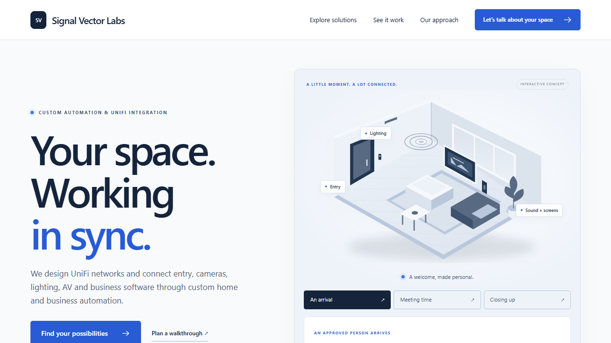

# Signal Vector Labs — website

The public website for Signal Vector Labs: UniFi network design and custom home and business automation (entry, cameras, Wi-Fi, sound, screens and lighting).

Plain Node.js, no dependencies.

## Run it

Requires Node.js 22 or later (24 LTS recommended).

    cd customer-kits-ui
    SITE_MODE=public npm start

Then open http://127.0.0.1:4173/. `PORT` and `HOST` override the defaults.

## Test

    cd customer-kits-ui
    npm test

## Configure

`customer-kits-ui/site-config.json` holds the business name, site URL, service areas and contact details. Leave a field empty rather than inventing a value; the pages and structured data only show what is set.

## Layout

- `server.mjs`: HTTP server, routing, canonical redirects, sitemap and robots.txt.
- `pages.mjs`, `services.mjs`, `visuals.mjs`: server-rendered pages, service content and illustrations.
- `index.html`, `customer.css`, `customer.js`: homepage template, styles and progressive enhancement.
- `site.test.mjs`: page, link, metadata and routing tests.

The sales workspace and its research and pricing data are private and not part of this repository.

